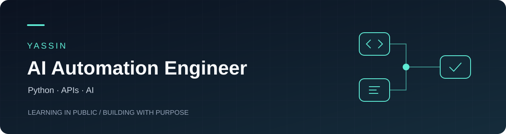

  

  <a href="https://github.com/yassinSoliman1/AI-Automation-Journey">Explore my work</a>
  &nbsp; · &nbsp;
  <a href="https://github.com/yassinSoliman1?tab=repositories">Repositories</a>

## Hi, I'm Yassin

I'm building practical skills in **AI automation engineering**, starting with Python, API integrations, and small tools that make everyday tasks easier.

My current public work includes a command-line AI chat prototype, a weather API app, and Python utilities. I use this GitHub to share code and document my progress as I develop more complete automation projects.

## Selected work

| Project | What you'll find |
| --- | --- |
| [OpenRouter chat assistant](https://github.com/yassinSoliman1/AI-Automation-Journey/blob/main/open%20router/main.py) | A Python chat prototype with conversation history and attempts across multiple models. |
| [Weather app](https://github.com/yassinSoliman1/AI-Automation-Journey/blob/main/weather%20app/weather_app.py) | A city-based weather tool using Open-Meteo geocoding and forecast APIs. |
| [Python utilities](https://github.com/yassinSoliman1/AI-Automation-Journey) | Contact management, a to-do list, notes, and other exercises in a public learning workspace. |

## Current foundation

**Python** · **HTTP APIs** · **Requests** · **JSON** · **Environment-based configuration**

These are technologies used in my current code. The projects are learning exercises and prototypes, and my portfolio is still growing.

## Where I'm heading

- Turn small scripts into useful automation workflows.
- Add clear setup guides, sample outputs, and demos.
- Improve input validation, error handling, and reliability.

---

<a href="https://github.com/yassinSoliman1/AI-Automation-Journey">AI Automation Journey →</a> Learning in public. Building one useful project at a time.
